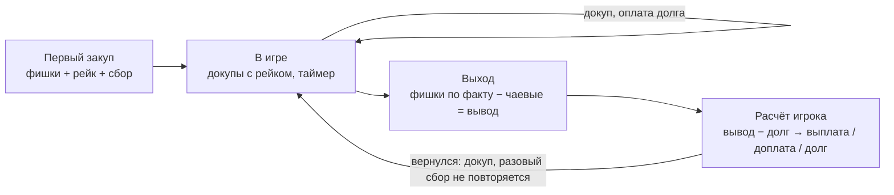

# ТЗ: Feltbook — банк покерного стола (Android)

Версия от 2 ноября 2026 · источник правды для разработки

## 1. Назначение и границы

Офлайн-приложение для Android, которое ведёт кассу банкира в домашней или клубной игре в техасский холдем: кто сколько закупил фишек, кто сколько уже заплатил, кто кому должен на выходе, сколько заработал банкир и сколько рейка отдать заведению.

**Рабочее название — Feltbook** («книга сукна» — кассовая книга покерного стола; имя Felt уже занято другим приложением), подпись под логотипом «банк покерного стола». Перед публикацией проверить, что имя свободно в Google Play и на GitHub.

**Входит в продукт:**

- создание игры с правилами комиссий, учёт игроков, закупов и докупов (сразу оплаченных или в долг);
- выход игрока с подсчётом фишек, чаевыми и расчётом «кто кому платит»;
- итоговый расчёт по игре: долг/выплата каждого игрока, доход банкира, рейк заведению, сверка фишек;
- передача текущей игры другому телефону по Bluetooth / Wi-Fi без интернета;
- локальная история игр со статистикой и удалением прошлых сессий.

**Не входит:** сервер, аккаунты, синхронизация через интернет, учёт раздач и ставок внутри игры, онлайн-платежи. Курс фиксирован: 1 фишка = 1 рубль, вывод 1:1.

## 2. Роли и термины

Приложением пользуется только банкир: телефон один, игроки в приложение не заходят.

| Термин | Значение |
| --- | --- |
| Банкир | Владелец игры в приложении. Выдаёт фишки, принимает и выплачивает деньги, отдаёт рейк. Может быть игроком или не играть |
| Дилер | Раздаёт карты. Для приложения это обычный игрок, отдельной роли нет |
| Игрок | Участник игры с произвольным именем. Банкир-игрок тоже игрок |
| Закуп (депозит) | Первая покупка фишек игроком |
| Докуп | Любая следующая покупка фишек тем же игроком |
| Оплачено / в долг | Игрок отдал деньги за закуп сразу или рассчитается при выходе |
| Сбор банкира | Разовая плата банкиру за вход в игру, только с первого закупа |
| Рейк | Плата заведению с каждого закупа и докупа |
| Чаевые | Фишки, которые игрок при выходе дарит банкиру или другому игроку, обычно чтобы округлить сумму вывода |
| Выход (кэш-аут) | Игрок сдаёт фишки, они меняются на рубли 1:1 |
| Расчёт | Сведение по игроку или по всей игре: кто кому сколько платит |
| Передача комнаты | Перенос текущей игры на телефон нового банкира |

## 3. Бизнес-правила и формулы расчёта

Все суммы — целые рубли (`Long`), без дробей. Правила комиссий задаются при создании игры и сохраняются в ней «слепком»: смена настроек по умолчанию не меняет уже идущие и прошлые игры.

### 3.1. Настройки комиссий (на игру)

| Параметр | Варианты | По умолчанию |
| --- | --- | --- |
| Сбор банкира | разово фиксированная сумма · разово % от первого закупа · с каждого закупа и докупа (фикс или %) | разово 100 ₽ |
| Рейк заведению | % от каждого закупа/докупа или фиксированная сумма за каждый | 10 % |
| Минимальная покупка | любая сумма фишек не меньше минимума, без шага и кратности | 500 фишек |
| Округление % | до целого рубля, математически; кратность 10 не требуется (закуп 1 250 → рейк 125 ₽) | вкл. |
| Оплата покупки | одним статусом на всю сумму или раздельно (фишки и комиссии отдельно) | одним статусом |
| Минимальное время игры | минуты от первого закупа | 60 мин |

Значения по умолчанию задаются в «Настройках». На экране «Новая игра» банкир видит их в блоке «Правила» и может изменить для этой игры перед стартом; после старта правила игры зафиксированы.

**Банкир-игрок** платит рейк со своих закупов, как все, а сбор банкира с себя не берёт ни в одном режиме.

### 3.2. Закуп и докуп

Каждая покупка фишек на сумму D создаёт в журнале до трёх записей: фишки, рейк и сбор банкира (если он положен по режиму). К оплате за покупку:

```latex
\text{К оплате} = D + \text{Рейк}(D) + \text{Сбор}(D)
```

```latex
\text{Сбор}(D) = \begin{cases} S_{fix}, & \text{«разово фикс», первый закуп} \\ \mathrm{round}(D \cdot s / 100), & \text{«разово \%», первый закуп} \\ S_{fix} \text{ или } \mathrm{round}(D \cdot s / 100), & \text{«с каждого закупа»} \\ 0, & \text{докуп в разовых режимах или игрок — банкир} \end{cases}
```

```latex
\text{Рейк}(D) = \begin{cases} \mathrm{round}(D \cdot p / 100), & \text{режим «процент»} \\ R_{fix}, & \text{режим «фикс»} \end{cases}
```

Примеры из правил стола:

| Покупка | Фишки | Рейк | Сбор банкира | К оплате |
| --- | --- | --- | --- | --- |
| Первый закуп в долг на 1 000, рейк 10 % | 1 000 | 100 | 100 | 1 200 |
| Первый закуп на 2 000, рейк 10 % | 2 000 | 200 | 100 | 2 300 |
| Первый закуп на 2 000, рейк 100 ₽ фикс | 2 000 | 100 | 100 | 2 200 |
| Докуп на 1 000, рейк 10 % | 1 000 | 100 | 0 | 1 100 |

Сумма закупа и докупа — произвольная, от минимальной покупки (по умолчанию 500 фишек): её набирают на клавиатуре или чипами быстрых сумм; меньше минимума кнопка «Выдать фишки» неактивна и под суммой видна подсказка «минимум 500». По умолчанию у покупки один переключатель на всю сумму: «В долг N фишек» (фишки и комиссии записываются в долг) или «Оплачено сейчас» (банкир получил всю сумму к оплате). Если в настройках игры включена раздельная оплата, в sheet появляются два переключателя: «Фишки» и «Рейк и сбор» — например, комиссии наличными сразу, фишки в долг. Частичную оплату долга можно внести в любой момент отдельной записью «Оплата».

### 3.3. Выход игрока

Банкир вводит количество фишек F на руках у игрока и, только если игрок сам этого хочет, чаевые (необязательны, по умолчанию выбрано «Без чаевых») T (кому и сколько). Сумма к выводу W и итог по игроку:

```latex
W = F - T_{\text{отдал}} + T_{\text{получил}}
```

```latex
\text{Баланс} = W - (\text{Начислено} - \text{Оплачено})
```

где «Начислено» — сумма всех закупов, рейка и сбора банкира игрока, «Оплачено» — всё, что он уже отдал банкиру. Баланс > 0 — банкир выплачивает игроку, < 0 — игрок доплачивает банкиру, 0 — квиты.

Чаевые банкиру идут в доход банкира. Чаевые игроку, который ещё за столом, добавляются к его фишкам; уже вышедшему — к его сумме вывода. Быстрые кнопки округления: «до 100» и «до 500» сами считают остаток (3 753 → чаевые 53 → вывод 3 700).

Результат игры по игроку (для статистики): W − сумма закупов (без рейка и сбора).

### 3.4. Ранний выход

До истечения минимального времени от первого закупа выход доступен, но с подтверждением «Исключительный случай» и пометкой в истории. На карточке игрока виден таймер «в игре 47 мин».

### 3.5. Итог по игре и контроль

```latex
\text{Рейк заведению} = \sum \text{Рейк}, \qquad \text{Доход банкира} = \sum \text{Сборы} + \sum \text{Чаевые банкиру}
```

```latex
\sum \text{Фишки закупов} = \sum F_{\text{при выходе}}
```

Второе равенство — сверка фишек: если на выходе фишек больше или меньше, чем было выдано, экран расчёта показывает расхождение и не даёт закрыть игру без подтверждения. Касса банкира после всех расчётов должна равняться рейку + доходу банкира; это показывается отдельной строкой «Должно быть на руках».

### 3.6. Сквозной пример

Банкир не играет, рейк 10 %, сбор 100 ₽.

| Игрок | Покупки | Начислено | Оплачено сразу | Фишки на выходе | Чаевые | Вывод | Баланс |
| --- | --- | --- | --- | --- | --- | --- | --- |
| Андрей | 1 000 в долг + докуп 1 000 в долг | 2 300 | 0 | 0 | — | 0 | платит 2 300 |
| Борис | 1 000 оплачено | 1 200 | 1 200 | 3 753 | 53 банкиру | 3 700 | получает 3 700 |
| Влад | 2 000 в долг | 2 300 | 0 | 1 247 | — | 1 247 | платит 1 053 |

Сверка: выдано 5 000 фишек, сдано 5 000. Рейк заведению 500 ₽, доход банкира 353 ₽ (сборы 300 + чаевые 53). Касса: пришло 4 553, выплачено 3 700, на руках 853 = 500 + 353.

Если банкир играет, он учитывается как обычный игрок с балансом относительно собственной кассы: рейк со своих закупов он кладёт в кассу, сбор с себя не берёт.

### 3.7. Игрок не расплатился

Редкий, но возможный случай: игрок получил фишки, не оплатил их сразу и при выходе не отдал долг (или отдал частично). Приложение не теряет эти деньги и не ломает расчёт.

- Любая неоплаченная покупка — это долг, даже если банкир не нажал «В долг»: статуса «ни то ни другое» нет, по умолчанию стоит «В долг».
- На экране выхода, кроме «Расчёт произведён», есть кнопка «Не заплатил» (и поле «Заплатил частично»). Игрок помечается «Ушёл с долгом N ₽», его фишки сдаются как обычно.
- Игру можно закрыть с открытым долгом. В итоге появляется блок «Не оплачено» с именем и суммой, а строка кассы показывает недостачу: «Недостача 1 053 ₽ — не получено от Влада».
- Рейк заведению по умолчанию считается полностью, как будто долг оплачен: банкир отвечает перед заведением, а с должником разбирается сам (настройка — см. решённые вопросы).
- Долг переходит в справочник игроков: на главной — блок «Открытые долги», в статистике игрока — сумма и дата.
- Когда должник садится за новый стол, при добавлении появляется предупреждение «Влад должен 1 053 ₽ с 18 окт» с кнопками «Погасить сейчас» и «Продолжить». Погашение записывается в старую игру, она перестаёт быть «с долгом».
- Долг можно списать вручную («Простить долг») — с подтверждением и записью в журнале; списанная сумма уменьшает доход банкира этой игры.

## 4. Функциональные требования

Игра проходит четыре состояния: создана → идёт → расчёт → закрыта (в истории); из «идёт» или «закрыта» её можно передать новому банкиру.

**Открытая сессия: вход и выход в любой момент.** Пока игра в статусе «идёт», состав стола меняется свободно:

- новый игрок добавляется в любой момент — его закуп считается первым (с ним сбор банкира и рейк), таймер минимального времени стартует от его собственного первого закупа;
- игрок выходит в любой момент: банкир вводит фактическое количество фишек на руках, приложение сразу считает баланс по формуле 3.3 — «Банкир выплачивает N ₽» или «Игрок доплачивает N ₽» — и после «Расчёт произведён» игрок помечается рассчитанным, а его фишки уходят из «фишек в игре»;
- вышедший игрок может вернуться в ту же сессию: это докуп: рейк берётся как с обычного докупа, сбор банкира — только в режиме «с каждого закупа»; прошлый расчёт сохраняется, новый выход считается только по новым покупкам и оплатам;
- сводка стола (фишек в игре, долги, касса) пересчитывается после каждого входа и выхода, итоговый расчёт игры собирает все промежуточные выходы.

**Счётчик докупов.** У каждого игрока рядом с именем виден значок «докуп ×N» (нет докупов — значка нет), общее число докупов за игру — на табло стола и в итоговом расчёте. Возврат вышедшего игрока считается докупом.



Сбор банкира берётся один раз за игру; каждый выход рассчитывается сразу по фактическим фишкам, без ожидания конца игры.

**Игры**

1. Создать игру: название (по умолчанию дата и время), имя банкира, «Банкир играет» да/нет, правила комиссий (3.1). Правила подставляются из последних использованных.
2. Одновременно активной может быть только одна игра; остальные — в истории.
3. Завершить игру: перевести всех оставшихся игроков в выход (ввести фишки по каждому) → экран итогового расчёта → «Закрыть игру».
4. Переоткрыть закрытую игру для исправления (с пометкой «изменено после закрытия»).

**Игроки и покупки**

1. Добавить игрока: имя (свободный текст, подсказки из прошлых игр), сумма первого закупа, «Оплачено сейчас» / «В долг». Показ итоговой суммы к оплате до подтверждения.
2. Докуп: сумма, оплачено/в долг, показ рейка и итога.
3. Внести оплату долга полностью или частично.
4. Отменить ошибочную запись: не удаление, а отменяющая запись с причиной (в интерфейсе — «Отменено»); в журнале видна вся история.
5. Переименовать игрока.

**Выход и чаевые**

1. Ввести фишки на руках, чаевые (получатель: банкир или любой игрок), быстрое округление.
2. Экран результата выхода: «Выплатить игроку N ₽» или «Получить с игрока N ₽», кнопка «Расчёт произведён».
3. Предупреждение о раннем выходе (3.4).

**Расчёт и сводка**

1. Табло в реальном времени наверху экрана стола — банкир в любой момент видит фактическое состояние денег и фишек:
   - **Фишки:** выдано всего, сдано вышедшими, сейчас в игре, число докупов за игру;
   - **Долги:** сколько игроки должны банкиру сейчас (сумма неоплаченных закупов и комиссий), сколько банкир должен вышедшим, но ещё не выплатил;
   - **Касса:** наличные на руках у банкира по журналу (получено − выплачено);
   - **Рейк:** накоплено для заведения (к отдаче в конце игры);
   - **Банкир:** накопленный доход — сборы + чаевые. Нажатие на любую цифру открывает расшифровку по игрокам.
2. Рейк заведению отдаётся одной суммой в конце игры: на экране итогового расчёта кнопка «Рейк отдан заведению» создаёт одну запись `RAKE_PAID` на всю накопленную сумму. До этого рейк лежит в кассе банкира и показывается отдельной строкой.
3. Итоговый расчёт: таблица по игрокам (начислено, оплачено, вывод, баланс, статус «рассчитан»), блоки «Банкиру», «Заведению», сверка фишек и кассы.
4. Поделиться итогом текстом через стандартное меню Android (мессенджер) и сохранить как изображение.

**История и статистика**

1. Список прошлых игр: дата, длительность, количество игроков, оборот, рейк, доход банкира.
2. Карточка игры только для чтения с полным журналом.
3. Удаление одной или нескольких игр (мультивыбор), подтверждение и «Отменить» в snackbar 5 с; кнопка «Удалить всё» в настройках.
4. Статистика по имени игрока за все игры: сыграно игр, суммарный результат, средний закуп, докупов за игру в среднем. Имена сопоставляются по точному совпадению с возможностью объединить двух игроков вручную.
5. Экспорт/импорт всей базы в файл (резервная копия).

**Пасхалка: калькулятор шансов**

1. **Как открыть.** 11 нажатий подряд по пункту «Настройки» в нижней панели (между нажатиями не больше 1 с, иначе счётчик сбрасывается). С 7-го нажатия — подсказка «Ещё 4…». После открытия в «Настройках» появляется пункт «Калькулятор шансов», его можно скрыть обратно.
2. **Ввод:** две свои карты (сетка колоды 13 × 4, занятые карты недоступны); число игроков 2–10; позиция (UTG … BB, список зависит от числа игроков; под выбором — памятка: UTG — первый после блайндов, MP — середина, CO — перед дилером, BTN — дилер, ходит последним после флопа, SB / BB — малый и большой блайнд); карты на столе — 0, 3, 4 или 5; банк и ставка, которую нужно уравнять; необязательно — известные мёртвые карты.
3. **Вывод:**
   - эквити — % победы, ничьей и проигрыша против случайных рук остальных игроков. Монте-Карло 100–200 тыс. раздач с погрешностью «±», на ривере и при малом числе вариантов — точный перебор;
   - текущая комбинация, ауты по видам (флеш, стрит, сет…) и точный шанс усилиться к следующей карте и к риверу; рядом — быстрая оценка по правилу 2 и 4 (ауты × 2 на одну улицу, × 4 на две);
   - шансы банка: нужная доля = ставка ÷ (банк + ставка) ([pot odds](https://en.wikipedia.org/wiki/Pot_odds)). Если эквити больше — «Колл окупается по шансам банка», иначе — «Колл не окупается». Только математика, без советов;
   - для префлопа — сила руки как «топ X % рук» и ориентир по позиции (из ранней позиции разыгрывают уже, с баттона — шире), помечено как ориентир.
4. **Расчёт** — офлайн, в отдельном модуле `:core:odds` на чистом Kotlin: табличный оценщик комбинаций по идеям [OMPEval](https://github.com/zekyll/OMPEval) (лицензия ISC — при заимствовании сохранить уведомление) и Монте-Карло в фоне с промежуточными результатами. Целевое время — до 1 с на среднем телефоне; пересчёт отменяется при любом изменении ввода.
5. Калькулятор не связан с кассой и ничего не сохраняет.

## 5. Экраны и UX

Дизайн — Material 3 (Material You / Expressive) по гайдлайнам Google: крупные цифры, минимум ввода, все частые действия под большим пальцем правой руки.

Макеты всех экранов — [Feltbook — макеты](https://claude.ai/artifact/BiBSuXQJ9AgWFirFh2rMAL); их копия для разработки лежит в репозитории в `docs/mockups/`.

### 5.1. Принципы

- **Зона большого пальца.** Главные действия внизу: FAB «+ Игрок» справа снизу, кнопки подтверждения во всю ширину внизу bottom sheet. Сверху только заголовок и второстепенное (меню, поиск).
- **Bottom sheet вместо отдельных экранов** для закупа, докупа, оплаты, выхода: игрок не теряет контекст стола.
- **Ввод сумм** — собственная цифровая клавиатура внутри sheet (кнопки 64 dp) + чипы быстрых сумм (500, 1 000, 2 000, 5 000, последняя сумма игрока). Системная клавиатура не появляется.
- **Итог до подтверждения:** под суммой всегда строка «Фишки 2 000 + рейк 200 + сбор 100 = 2 300 ₽».
- **Цвет несёт смысл:** зелёный — игроку выплатить, красный — с игрока получить, нейтральный — квиты. Цвет дублируется знаком и словом (доступность).
- **Тёмная тема по умолчанию** (игра обычно вечером, при приглушённом свете), светлая и системная — в настройках; Dynamic Color с Android 12, иначе своя палитра «сукно» (тёмно-зелёный + золото).
- **Edge-to-edge**, predictive back, тактильный отклик на подтверждениях, опция «Не гасить экран во время игры».
- **Без потерь:** любое действие отменяется через snackbar «Отменить» или отменой записи в журнале; при закрытии приложения ничего не теряется (запись в БД сразу).
- Сенсорные цели ≥ 48 dp, поддержка размера шрифта до 200 %, TalkBack-описания для всех сумм, адаптация под планшет/foldable (две колонки: список игроков + детали).

**Защита от случайных нажатий.** Подтверждение ставится по цене ошибки, а не на каждое действие: если спрашивать всё подряд, банкир начнёт прокликивать диалоги не читая и они перестанут защищать.

| Уровень | Действия | Защита |
| --- | --- | --- |
| Обратимое | Докуп, оплата долга, добавление игрока, переименование | Итог виден до нажатия; после — snackbar «Отменить» 5 с, дальше — отмена записи в журнале |
| Деньги на руки | «Расчёт произведён» при выходе, «Рейк отдан» | Удержание кнопки 0,6 с с заполняющейся полоской и вибрацией; кнопка повторяет сумму («Выплатить 300 ₽») |
| Необратимое | Закрыть игру, удалить игры, передать комнату, ранний выход | Диалог с конкретными последствиями и глаголом на кнопке («Удалить 3 игры»), отмена — кнопка по умолчанию; для «Удалить всё» — ввести слово «УДАЛИТЬ» |
| Подозрительная сумма | Покупка больше 5× средней покупки игры или больше 20 000; фишек на выходе больше, чем есть в игре | Предупреждение в шторке до подтверждения: «20 000 фишек — точно? Обычно здесь берут 2 000» |

Дополнительно:

- **Двойной тап:** после нажатия основная кнопка блокируется до завершения операции, повторные нажатия в течение 600 мс игнорируются — одна покупка не запишется дважды.
- **Свайпы по карточке игрока** срабатывают только после 40 % ширины, с вибрацией в точке срабатывания; на половине пути карточка возвращается.
- **Закрытие шторки с введённой суммой** (свайп вниз, «назад», тап мимо) — вопрос «Отменить ввод?»; пустая шторка закрывается сразу.
- **Опасные кнопки не стоят рядом с частыми:** «Удалить», «Ранний выход», «Закрыть игру» — в меню «⋮» или отдельным экраном, не у FAB и не в зоне жеста «назад».
- **Разные формы для разных действий:** главное действие — латунная кнопка, отмена — контурная, необратимое — красный текст на нейтральном фоне, чтобы их нельзя было спутать по пятну цвета.

**Суммы никогда не переносятся.** В строке игрока сумма занимает правую колонку шириной не больше половины строки и всегда в одну строку. Если число не помещается (например, −125 400 ₽ при крупном шрифте), шрифт плавно уменьшается до 70 % от исходного, но не меньше 12 sp. В Compose это `BasicText` с `autoSize = TextAutoSize.StepBased(minFontSize = 12.sp)` и `maxLines = 1`. Уступает место левая часть: имя и подпись обрезаются многоточием, полное значение видно в карточке игрока. То же правило — для табло, итогового расчёта и шторок.

### 5.2. Экраны

| Экран | Содержимое | Главное действие |
| --- | --- | --- |
| Главная | Логотип Feltbook, карточка идущей игры, блок «Открытые долги», прошлые игры | FAB «Новая игра» |
| Новая игра | Название, банкир, «Я тоже играю», правила с живым примером расчёта | «Начать игру» |
| Стол | Табло: фишки в игре, докупы, касса, долги, рейк, банкиру. Карточки игроков со значком «докуп ×N»; свайп вправо — докуп, влево — выход | FAB «+ Игрок» |
| Новый игрок (sheet) | Имя с подсказками, предупреждение о старом долге, первый закуп, оплата | «Выдать N фишек» |
| Карточка игрока (sheet) | Куплено, начислено, долг; «Докуп», «Оплата», «Выход»; журнал с отменой записей | «Докуп» |
| Закуп / докуп (sheet) | Сумма от 500, фишки-номиналы, клавиатура, «В долг / Оплачено сейчас», расшифровка итога | «Выдать N фишек» |
| Выход (sheet) | Фишки на руках, чаевые (по умолчанию нет), итог «выплатить / получить» | «Расчёт произведён» (удержание), «Отдал часть…», «Не заплатил» |
| Итоговый расчёт | Сверка фишек, рейк, банкиру, касса, блок «Не оплачено», игроки | «Закрыть игру» (удержание), «Поделиться» |
| Открытые долги | Должники: сумма, игра, дата, частичные оплаты | «Погасить», «Простить…» |
| Передача комнаты | Отдать / принять, код из 4 цифр, акт передачи кассы | «Передать» (удержание) |
| История | Игры по месяцам, фильтр периода, мультивыбор, удаление с диалогом | — |
| Статистика | Итоги периода, доход банкира по играм, игроки и докупы | — |
| Настройки | Правила по умолчанию, тема, «не гасить экран», вибрация, резервная копия, «Удалить все игры»; после пасхалки — пункт «Калькулятор шансов» (экран: карты, игроки, позиция, стол, банк → эквити, ауты, шансы банка) | — |

Навигация: нижняя панель из трёх пунктов — «Игра», «История», «Настройки»; на экране стола панель скрывается при прокрутке.

### 5.3. Визуальный стиль «Сукно»

Приложение выглядит как стол клуба, а не как калькулятор: тёмное зелёное сукно, латунные акценты, фишки и масти как система знаков. Казино-китча (неон, блёстки, 3D-золото) нет — сдержанно, как в премиальном банковском приложении.

| Элемент | Решение |
| --- | --- |
| Фон | Тёмное сукно `#0B2A20` → `#071A14` с едва заметной фактурой ткани (шум 2–3 %), карточки `#12352A` |
| Акцент | Латунь `#C9A35B` — главные кнопки, FAB, активные состояния; текст на ней `#1A1408` |
| Смысловые цвета | Выплатить игроку — `#4CC38A`, получить с игрока — `#E5484D`, нейтрально — `#9FB5AC`; всегда со знаком и словом |
| Номиналы фишек | 100 — красная, 500 — зелёная, 1 000 — чёрная, 5 000 — фиолетовая, 10 000 — латунь; чипы быстрых сумм нарисованы как настоящие фишки с краевыми полосками |
| Шрифты | Заголовки и бренд — Playfair Display (кириллица); интерфейс и цифры — IBM Plex Sans; служебные строки (время, закуп, расшифровки) — IBM Plex Mono в приглушённом пергаментном цвете \`#B5AE96\`, как записи в банковской книге; с табличными цифрами (`tnum`), чтобы столбцы сумм не прыгали |
| Масти | Значки разделов: ♠ игроки, ♦ касса, ♣ рейк, ♥ банкир. Аватар игрока — карта-миниатюра с инициалом и мастью |
| Табло стола | Овал «стола» со светлым бортом, в центре — фишек в игре; по краю — касса, долги, рейк, доход банкира |
| Движение | Закуп — стопка фишек «съезжает» к игроку (300 мс, emphasized easing), выход — фишки возвращаются в банк; смена баланса — счётчик-прокрутка цифр; тактильный отклик на подтверждениях |
| Светлая тема | «Бумага и латунь»: `#F6F2E8` фон, зелёный `#0F4A37` как акцент; Dynamic Color выключен по умолчанию, чтобы сохранить фирменный стиль, включается в настройках |

**Шрифты и лицензии.** Проект open source, поэтому в репозиторий кладутся только шрифты под SIL Open Font License 1.1: их можно встраивать в APK и распространять в исходниках. Коммерческие шрифты (Graphik, Suisse, TT Norms и т. п.) не подходят: их лицензия запрещает выкладывать файлы в публичный репозиторий.

| Роль | Шрифт | Лицензия | Почему |
| --- | --- | --- | --- |
| Заголовки, бренд, инициалы на картах | Playfair Display | OFL 1.1 | Классическая антиква с высоким контрастом — «клубный» характер, кириллица есть |
| Интерфейс и суммы | IBM Plex Sans | OFL 1.1 | Строгий «банковский» гротеск с полной кириллицей и табличными цифрами; рядом с Playfair даёт пару «клуб + касса» |
| Служебные строки, журнал операций | IBM Plex Mono | OFL 1.1 | Моноширинные цифры как в кассовой книге; из той же семьи, что и Plex Sans, поэтому не спорит с ним |
| Запасной вариант интерфейса | Golos Text (ParaType) | OFL 1.1 | Спроектирован под русский язык, если Plex покажется слишком строгим |

Подключение: файлы `.ttf` в `res/font`, нужны начертания Plex Sans 400/500/600/700 и Plex Mono 400/500; в Compose — свой `Typography` для Material 3 (display/headline — Playfair Display, title/body/label — IBM Plex Sans, мелкие служебные строки — IBM Plex Mono) и `fontFeatureSettings = "tnum"` для всех сумм. В корне репозитория — `OFL.txt` для каждого шрифта.

**Иконка (adaptive icon):** фон — сукно `#0B2A20` с лёгкой виньеткой; передний план — монограмма F цвета слоновой кости (Playfair Display Black, переведённая в кривые) в латунном кольце фишки с восемью краевыми вставками, под буквой маленькая латунная пика ♠ (вариант A в макетах). Монохромный слой для тематических иконок Android 13+ — кольцо и буква F. Читается на 48 px: кольцо и одна буква, мелкие вставки и пика на 48 px убираются.

## 6. Передача комнаты

Игра целиком (правила, игроки, журнал) переносится на телефон нового банкира через Google Nearby Connections — он сам выбирает Bluetooth, BLE или Wi-Fi и работает без интернета и без общей сети.

**Два сценария:**

1. **Посреди игры** — банкир уходит, игра продолжается. Новый банкир получает текущее состояние и ведёт его дальше. Старый банкир, если играл, остаётся в игре как обычный игрок или сразу выходит через расчёт.
2. **После расчёта** — все рассчитаны, назначен новый банкир. Он получает список игроков и правила как шаблон для новой игры.

**Процесс:**

1. Получатель открывает «Принять игру» (рекламирует себя), отправитель — «Передать игру» (ищет устройства).
2. Оба экрана показывают одинаковый 4-значный код; оба нажимают «Код совпадает».
3. Отправитель формирует «Акт передачи кассы»: сколько наличных он должен физически отдать новому банкиру (касса минус уже отданный рейк минус доход старого банкира, который он оставляет себе — выбор в акте).
4. Отправляется пакет: JSON (kotlinx.serialization) с версией схемы и контрольной суммой SHA-256.
5. Получатель проверяет версию и сумму, показывает сводку («6 игроков, в игре 12 000 фишек, касса 4 300 ₽») и кнопку «Принять». После принятия — запись «Игра принята от <имя банкира>» в журнале.
6. У отправителя игра переходит в статус «Передана» (только чтение, остаётся в истории).

**Доход разных банкиров** в одной игре учитывается раздельно: каждая запись журнала хранит имя банкира, при котором она сделана.

**Запасной путь** (нет Google Play Services, Nearby не соединяется): экспорт игры в файл `.pokerbank` и отправка через стандартное меню «Поделиться» (Telegram, Quick Share, почта), импорт открытием файла. Формат тот же, что у Nearby.

**Разрешения:** Android 12+ — `BLUETOOTH_SCAN`, `BLUETOOTH_ADVERTISE`, `BLUETOOTH_CONNECT`, `NEARBY_WIFI_DEVICES` (Android 13+); до 12 — геолокация. Запрашиваются только в момент передачи, с пояснением зачем.

## 7. Технологический стек

Нативный Android на Kotlin + Jetpack Compose — официальный стек Google, лучшая поддержка Material 3 и Nearby Connections; кроссплатформа (Flutter, KMP) не нужна, пока iOS не в планах.

| Слой | Выбор | Почему |
| --- | --- | --- |
| Язык | Kotlin 2.x (K2), корутины, Flow | Стандарт Android, null-safety для денег |
| UI | Jetpack Compose + Material 3 (Compose BOM, последняя стабильная) | Material You, Dynamic Color, bottom sheets, адаптивные лейауты из коробки |
| Адаптивность | `material3-adaptive` (ListDetailPaneScaffold) | Планшеты и foldable — две панели |
| Навигация | Navigation Compose с типобезопасными маршрутами | Single Activity, predictive back |
| Архитектура | Clean-ish: UI → ViewModel (StateFlow, UDF/MVI) → UseCase → Repository | Расчётная логика отдельно и покрыта тестами |
| DI | Hilt | Рекомендация Google, интеграция с ViewModel |
| База | Room + KSP, миграции со схемами в репо | Локальная история, транзакции, Flow-запросы |
| Настройки | DataStore (Preferences) | Тема, правила по умолчанию |
| Сериализация | kotlinx.serialization (JSON) | Передача комнаты, экспорт/импорт |
| Передача | Google Play Services Nearby Connections (стратегия P2P\_POINT\_TO\_POINT) + Android Sharesheet как запасной путь | BT/Wi-Fi без интернета |
| Время | kotlinx-datetime | Таймеры игры, длительность |
| Графики статистики | Vico | Compose-нативные графики |
| Тесты | JUnit 5, Turbine (Flow), Compose UI Test, Robolectric; скриншот-тесты Roborazzi | Расчёты и ключевые экраны |
| Качество | ktlint/detekt, Android Lint, Baseline Profiles | Стиль, плавный старт |
| Сборка | Gradle Kotlin DSL, version catalog, AGP последний стабильный; GitHub Actions на self-hosted runner | Подписанный APK/AAB |

**Платформа:** minSdk 26 (Android 8.0), targetSdk — актуальный уровень, требуемый Google Play на дату релиза.

**Модули:**

- `:core:domain` — чистый Kotlin без Android: модель, правила комиссий, движок расчёта (функции из раздела 3). 100 % юнит-тестов.
- `:core:data` — Room, DataStore, репозитории, экспорт/импорт.
- `:core:transfer` — Nearby Connections, формат пакета, проверка целостности.
- `:core:ui` — тема, цвета, цифровая клавиатура, общие компоненты.
- `:feature:game`, `:feature:settlement`, `:feature:history`, `:feature:settings` — экраны.
- `:app` — точка входа, навигация, DI.

## 8. Модель данных

Все деньги и фишки хранятся журналом операций (append-only ledger): балансы не хранятся, а вычисляются из записей. Так проще передавать игру, исправлять ошибки отменяющими записями и доказывать расчёт.

| Сущность | Поля | Примечание |
| --- | --- | --- |
| `Game` | id (UUID), title, createdAt, closedAt?, status (CREATED, RUNNING, SETTLING, CLOSED, HANDED\_OVER), currentBankerName, bankerIsPlayer, rules (встроенный слепок), schemaVersion | Одна активная одновременно |
| `GameRules` | bankerFeeMode (ONCE\_FIXED, ONCE\_PERCENT, EACH\_FIXED, EACH\_PERCENT), bankerFeeValue, rakeMode (PERCENT/FIXED), rakeValue, splitPayment, minPlayMinutes | Встраивается в `Game` (`@Embedded`) |
| `Player` | id, gameId, name, isBanker, joinedAt, firstBuyInAt?, status (PLAYING, CASHED\_OUT, LEFT\_WITH\_DEBT), settledAt? | Вернувшийся игрок снова PLAYING |
| `LedgerEntry` | id, gameId, playerId?, type, amount (Long, ₽), counterpartyPlayerId?, bankerName, createdAt, reversesEntryId?, note? | Только добавление |
| `PlayerName` | name, firstSeenAt, mergedInto? | Справочник для подсказок, статистики и открытых долгов (долг считается из журнала игр) |
| `Handover` | id, gameId, fromBanker, toBanker, cashHandedOver, at | Акт передачи кассы |

**Типы записей `LedgerEntry.type`:** `BUY_IN` (фишки), `RAKE`, `BANKER_FEE`, `PAYMENT` (игрок → банкир), `CASH_OUT` (сданные фишки), `TIP` (от игрока к банкиру или игроку), `PAYOUT` (банкир → игрок), `RAKE_PAID` (банкир → заведение), `REVERSAL` (отмена записи), DEBT\_FORGIVEN (долг прощён).

По таблицам — индексы на gameId и playerId; удаление игры — каскадное (`ON DELETE CASCADE`) в одной транзакции.

## 9. Нефункциональные требования, тестирование, этапы

**Нефункциональные требования**

- Работа полностью офлайн; разрешение `INTERNET` в манифесте не объявляется.
- Каждая операция пишется в БД сразу, в транзакции; после убийства процесса или разряда телефона игра восстанавливается целиком.
- Холодный старт до 1 с на среднем устройстве, прокрутка 60 fps при 20 игроках.
- Данные не покидают устройство, кроме явной передачи или экспорта пользователем. Опционально — вход в приложение по биометрии.
- Интерфейс на русском, строки в ресурсах (готовность к локализации), суммы с разделителем тысяч и знаком ₽.

**Тестирование**

- Юнит-тесты движка расчёта: все примеры из раздела 3, вход/выход посреди игры, возврат вышедшего игрока, банкир-игрок, чаевые игроку и банкиру, отмена записей, ранний выход, расхождение фишек.
- Тесты миграций Room на каждую версию схемы.
- Тест сериализации пакета передачи: экспорт → импорт даёт идентичный журнал.
- UI-тесты ключевого сценария: создать игру → 3 игрока → докуп → выход с чаевыми → итог.
- Ручная проверка передачи на парах устройств: Android 8, 12, 14+, один без Google Play Services (запасной путь).

**Этапы**

1. MVP: игра, игроки, закуп/докуп, вход и выход в любой момент, чаевые, итоговый расчёт, история с удалением, долги игроков (выход без оплаты, открытые долги, предупреждение при посадке).
2. Передача комнаты (Nearby + файл), акт передачи кассы.
3. Статистика по игрокам, графики, экспорт/импорт базы, «Поделиться итогом» картинкой.
4. Пасхалка «Калькулятор шансов» (\`:core:odds\`). Полировка: планшеты, анимации Material Expressive, Baseline Profiles, публикация.

**Решённые вопросы**

- [x] Сбор банкира: три режима (разово фикс, разово %, с каждого закупа); по умолчанию разово 100 ₽, банкир меняет перед созданием игры.
- [x] Банкир-игрок платит рейк, сбор с себя не берёт.
- [x] Рейк не округляется до десятков: закуп 1 250 → 125 ₽.
- [x] Оплата по умолчанию одним статусом («в долг N фишек» или «оплачено сразу»), раздельная оплата — опция игры.
- [x] Рейк отдаётся заведению одной суммой в конце игры; по ходу игры накопленный рейк, долги, касса и фишки видны на табло.

* [ ] Если игрок ушёл с долгом — рейк заведению всё равно отдаётся полностью или только с оплаченного? По умолчанию полностью.
